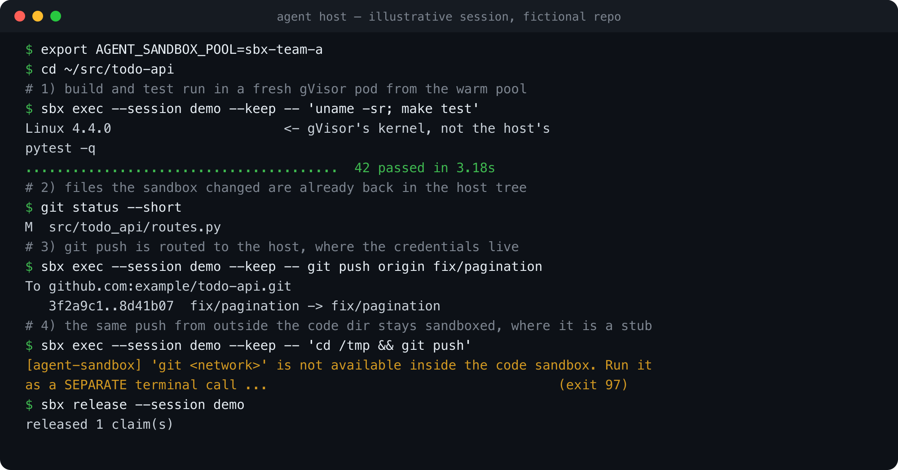
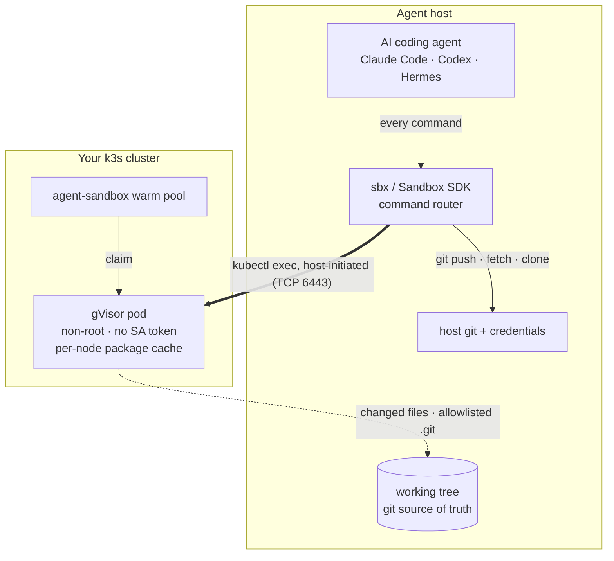

<div align="center">

# 🧊 self-hosted-agent-sandbox

**Let your AI coding agent run commands in a throwaway gVisor sandbox on your own k3s nodes, while its git credentials stay on the host.**

English · [简体中文](README.zh-CN.md)

[](https://pypi.org/project/self-hosted-agent-sandbox/) [](https://github.com/xiaoyaner0201/self-hosted-agent-sandbox/actions/workflows/ci.yml) [](LICENSE) [](pyproject.toml) [](https://gvisor.dev) [](https://github.com/kubernetes-sigs/agent-sandbox)



<sub>Illustrative session with a fictional repo.</sub>

</div>

---

## 🤔 Why

A coding agent such as Claude Code, Codex or Hermes normally runs `make`, `npm install` and `pytest` **on the machine it lives on**. Those commands execute whatever the repository, its dependencies and its post-install scripts contain, with your user's files, SSH keys, cloud tokens and network in reach. One prompt injection in an issue, or one malicious package, is enough.

Containers on the same host help, but they share the kernel and are usually mounted with the same credentials. Hosted sandboxes move your code to someone else's machines.

This project keeps the agent where it is and sends **only the commands it executes** to a gVisor pod on nodes you own. Code is synced both ways, so the host tree stays the git source of truth, and the handful of commands that need credentials (`git push`, `fetch`, `clone`, …) are routed back to the host.

## ✨ Highlights

- 🧊 **gVisor isolation, no KVM needed.** Each session gets its own pod with a user-space kernel, non-root, without a service-account token. Ordinary cloud VMs work.
- ⚡ **Warm pool.** A sandbox is claimed from a pre-started pool in about 0.2 s and deleted when the session ends. Pools are shared across nodes, each node keeps per-tenant package caches.
- 🔑 **Credentials stay home.** No host variable is forwarded unless you name it. Git network commands run on the host; inside the sandbox they are stubs that exit 97 with a hint.
- 🔁 **Two-way code sync with guard rails.** Pull-back into `.git` is an allowlist, so nothing built in the sandbox can plant a hook that the host later runs.
- 🐍 **Small surface.** A pure-Python SDK (`Sandbox`) and a CLI (`sbx`), standard library only, `kubectl` as the only binary.
- 🏗️ **Cluster recipes included.** Node install with a hard pod memory budget, gVisor, least-privilege RBAC and kubeconfig, per-tenant pools, cache GC.

> [!IMPORTANT]
> The sandbox protects the host from what the agent runs; it does not hide what you send into it. Files in the code dirs and sync paths travel as they are, and every forwarded variable is readable by every command in the sandbox. Keep real keys out of the working tree and read [Security](#-security) before you point a production agent at it.

## 🏗️ Architecture



The host always opens the connection: the cluster never needs a route back to the agent host, and no sandbox gets an inbound rule.

## 🚀 Quick start

**1. Nodes** (on every Linux machine; the script fetches the official k3s installer, or uses `$SBX_DL/install-k3s.sh` when air-gapped)

```bash
# first node (becomes the k3s server)
SBX_NODE_IP=10.0.0.11 cluster/node-install.sh server
sudo cat /var/lib/rancher/k3s/server/node-token     # copy this to the other nodes as ./node-token

# every other node
SBX_NODE_IP=10.0.0.12 cluster/node-install.sh agent https://10.0.0.11:6443 ./node-token

# every node
cluster/gvisor-node.sh
cluster/cache-gc-install.sh      # optional: daily cache prune
```

**2. Cluster** (once, on the first node, where `kubectl` is `k3s kubectl`)

```bash
kubectl apply --server-side -f https://github.com/kubernetes-sigs/agent-sandbox/releases/download/v1.0.9/sandbox-with-extensions.yaml
kubectl create namespace sbx
kubectl apply -f cluster/runtimeclass.yaml -f cluster/rbac.yaml
cluster/render-pool.py --tenant team-a --image ghcr.io/you/agent-host:latest \
    --cache-mount /var/cache/pkg | kubectl apply -f -
cluster/make-kubeconfig.sh https://10.0.0.11:6443 > agent-sandbox.kubeconfig   # copy to the agent host
```

> [!TIP]
> Use the **same image** your agent host runs. Paths, toolchains and cache variables then match on both sides with no extra configuration.

**3. Agent host**

```bash
pip install self-hosted-agent-sandbox
export AGENT_SANDBOX_KUBECONFIG=$PWD/agent-sandbox.kubeconfig AGENT_SANDBOX_POOL=sbx-team-a
cd /workspaces/my-repo
sbx exec --session demo -- 'cat /proc/version; make test'     # runs in a fresh gVisor sandbox
sbx exec --session demo -- git push origin HEAD                # runs on this host, with its credentials
```

`--keep` keeps the claim, so later `sbx exec --session demo --keep` calls share one sandbox until `sbx release --session demo`. `kubectl` must be on `PATH`, or set `AGENT_SANDBOX_KUBECTL`.

From Python:

```python
from self_hosted_agent_sandbox import Sandbox
sb = Sandbox(cwd="/workspaces/my-repo", session="task-42")
print(sb.execute("pytest -q")["output"])
sb.close()  # legacy best-effort async delete, not a reclamation receipt
```

For public allocation snapshots, constructor-failure recovery and opt-in bounded release with exact claim/Sandbox/Pod read-back, see [Lifecycle ownership](docs/lifecycle.md). `close()` and session-label `release()` retain their existing behavior.

## 🔌 Supported agents

| Agent / platform | How | Status |
|---|---|---|
| [Hermes Agent](https://github.com/NousResearch/hermes-agent) | terminal backend plugin: [**hermes-sandbox-cluster**](https://github.com/xiaoyaner0201/hermes-sandbox-cluster) | ✅ in use; acceptance suites pass on Hermes 0.21.5 and 0.22.7 |
| Claude Code | built-in Bash/Read/Write/Edit/Glob/Grep switched off, the same tools served by an `sbx mcp` server backed by the sandbox | 🧪 prototype ran end to end on a lab cluster; not in a release yet |
| Codex CLI | native remote execution environment: `codex exec-server` runs in the sandbox behind a stdio relay | 🧪 prototype ran end to end on a lab cluster; not in a release yet |
| Multica runtimes | through the agent adapters above; covers assigned issues, webhook autopilots (e.g. on `pull_request`) and PR wakeups | 🛠️ planned |
| [OmniRoute](https://github.com/cheaper-inference/OmniRoute) | `agent-sandbox` skill runtime: `execute_command` / `eval_code` claim a pod from the pool ([guide](docs/omniroute.md)) | ✅ upstream PR [#19130](https://github.com/cheaper-inference/OmniRoute/pull/19130) merged; verified on a lab cluster |
| [Temporal](https://temporal.io) | Activity calls the Python `Sandbox` API: claim → exec → verified cleanup ([guide](docs/temporal.md)) | 🧪 consumer-owned adapter candidate; isolated SDK 0.3.0 canary recorded, not bundled here |

Anything else can call the CLI or the library directly.

## ⚖️ How it compares

| Option | What it is | Where this project differs |
|---|---|---|
| [E2B](https://e2b.dev) | Firecracker microVM sandboxes behind an SDK, hosted or self-hosted | Runs on plain k3s with gVisor, so nodes need no KVM; built around an agent that already lives on a host, with code sync and host-routed git |
| [Daytona](https://www.daytona.io) | A sandbox platform with its own API server, workspaces and dashboard | A library and CLI on top of Kubernetes primitives; no server of its own to operate |
| [kubernetes-sigs/agent-sandbox](https://github.com/kubernetes-sigs/agent-sandbox) on its own | CRDs and a controller for sandbox pods and warm pools | This project uses it as the base and adds claim/exec/release, two-way code sync, host-command routing and cluster recipes |
| Docker containers or the agent's built-in sandbox | Isolation on the agent's own machine | Shares the host kernel and machine; here commands run on other nodes under gVisor, and pools are shared across agents |

Pick whichever fits: a hosted service is less work if your code may leave your machines; this project is for teams that want the agent's commands on hardware they control.

## 🧩 What is in this repo

| Part | What it is |
|---|---|
| `cluster/` | node install with a hard pod memory budget, gVisor, least-privilege RBAC and kubeconfig, per-tenant warm pools with per-node caches, cache GC |
| `src/self_hosted_agent_sandbox/` | the core library (`Sandbox`): claim / renew / release, environment and file sync, two-way code sync with a `.git` allowlist, host-command routing. Pure Python, no dependencies |
| `sbx` | a CLI over the core: `sbx exec`, `sbx shell`, `sbx release` |

The **Python `Sandbox` API** and `sbx` CLI are the supported entry points. There is **no HTTP server or durable job service** in SDK 0.4.0. Integrations own orchestration, cancellation and cleanup verification; Kubernetes is the underlying platform, not a reason for each caller to build another Job backend.

**0.4.0** adds public allocation/verified-release APIs and acknowledged/strict receipt. Source and installed-wheel local gates passed; the new APIs are not claimed as live Kubernetes/gVisor/Temporal acceptance (the Temporal canary exercised 0.3.0). See [release notes](docs/releases/0.4.0.md).

The SDK owns command routing, local subprocess cleanup and file transfer. The controller owns scheduling/expiry; adapters own durable recovery, cancellation policy and artifact validation. API-resource absence, remote process death and artifact delivery are separate verdicts.

## Explicit lifecycle and artifact ownership

```python
from self_hosted_agent_sandbox import Sandbox

# Caller supplies an atomic, durable save_target(Allocation) implementation.
# Persist target._asdict(); restore with Allocation(**saved_json).
sb = Sandbox(cwd="/workspaces/my-repo", session="attempt-unique-id",
             on_allocation=save_target,
             config={"agent_sandbox_strict_pull": True})
result = sb.execute("make && mkdir -p out && cp dist/package.tar.gz out/package.tar.gz")
if result["returncode"] != 0:
    raise RuntimeError("build failed")
# Validate expected out/package.tar.gz, its length and hash on the host here.
# Quiesce/join other execution owners, then explicitly release (does NOT pull):
released = sb.release_verified(timeout=15)
```

This is the success path, not a complete exception policy. On a receipt failure the command may already have run: repair transport/disk or move/remove a conflicting host file/directory, then retry **`sb.pull()` on the same instance**, not the command or constructor. Strict close retains the claim on receipt failure; `force_remove=True` does not bypass it. Default close remains best-effort/async and can discard unreceived results. Pending receipt blocks the next stale push in either mode. No automatic recursive host-tree deletion resolves type conflicts.

Persist `error.allocation` / `ReleaseError.allocation` and recover with `Sandbox.release_allocation(target, config=original_config, timeout=15)`; preserve the original execution error separately. Verified release requires opt-in Sandbox CR observer permission, fails closed on missing inventory, and verifies exact API names/UIDs, **not physical process death**. See [full lifecycle contract](docs/lifecycle.md).

## Checkpoints and forks (opt-in)

With `AGENT_SANDBOX_CHECKPOINT=true`, every `execute()` whose edits were pulled back records the host work tree as a git commit on a hidden ref `refs/sbx/<session>/<seq>` (parent = previous checkpoint, the first one's parent = HEAD at that moment) and adds `"checkpoint": "<sha>"` to the result. Your HEAD, branches and index are not touched. `sb.fork(sha, cwd=new_dir, session=new)` (or `sbx fork SHA DIR`) checks that state out as a detached worktree and starts a new sandbox there; `sbx checkpoints --session X [--prune]` lists or deletes the refs.

It restores **code-directory files only**: API calls, database writes and pushes are not undone. `.gitignore`d paths, the never-synced dirs (`node_modules`, `build`, `dist`, …) and anything outside the repository are not in a checkpoint. See [checkpoint contract](docs/checkpoint.md).

## Build capability boundary

- Run ordinary toolchains already present in the sandbox image; dependencies, network policy and resource limits remain operator choices.
- An isolated rootless BuildKit **COPY-only** OCI export was exercised. That does not establish a general container builder: Dockerfile **RUN** was restricted by the current sandbox's namespace/mount/security constraints. Do not advertise Docker-in-Docker, privileged builds, arbitrary Dockerfiles or image push as supported.
- `dist`, `build`, `node_modules` and other [excluded directories](docs/artifact-pull.md#directory-exclusions-and-explicit-export--目录排除与显式导出) stay excluded. Copy only named outputs into a non-excluded `out/` within a code dir; strict receipt is not expected-artifact/hash validation or durable artifact storage.

## 🧭 What runs where

A command runs on the host only when it is listed host commands plus glue that cannot touch files: a leading `cd <dir> &&` (an existing directory reached without symlinks), `echo`/`printf`, and filters fed by a pipe (`grep`, `jq`, `head`, `tail`, `sort`, `uniq`, `cut`, `tr`, `wc`) with short options from a fixed list, plus `>/dev/null`. It must also stay inside the code dirs: the working directory, every `cd` and every local path in a git command (a clone target, a `file://` remote) must resolve inside them, and `$VAR`, `~` and unquoted globs are not expanded on the host. Anything with a substitution, subshell, heredoc, file redirection, another program, a variable prefix other than on/off switches such as `GIT_TRACE=1`, or a git option that runs a program (`--upload-pack`, `clone -u/-c/--template`, …) stays in the sandbox.

> [!IMPORTANT]
> List **exact sub-commands**, never a whole CLI that can run user-defined code. `gh` aliases and extensions, for example, execute arbitrary programs, so list `gh pr create`, `gh pr view` rather than `gh`. Inside the sandbox a listed CLI is a stub that prints a hint and exits with code 97, so the agent learns to issue it separately.

## ⚙️ Configuration

Environment variables (adapters may also take them from their own config, e.g. Hermes `config.yaml` as `agent_sandbox_*`):

| Variable | Default | Purpose |
|---|---|---|
| `AGENT_SANDBOX_POOL` | `agent-4g` | warm pool to claim from |
| `AGENT_SANDBOX_NAMESPACE` | `sbx` | namespace of pool and claims |
| `AGENT_SANDBOX_KUBECONFIG` | `~/.kube/agent-sandbox.yaml` | least-privilege kubeconfig |
| `AGENT_SANDBOX_KUBECTL` | `kubectl` | kubectl binary |
| `AGENT_SANDBOX_SYNC_PATHS` | – | config files/dirs pushed at the same path |
| `AGENT_SANDBOX_CODE_DIRS` | task dir | two-way synced code dirs |
| `AGENT_SANDBOX_STRICT_PULL` | `false` | propagate post-command receipt failure; strict close retains the claim on receipt failure. See [artifact receipt contract](docs/artifact-pull.md) |
| `AGENT_SANDBOX_HOST_COMMANDS` | git network ops, `git remote add/set-url` | command prefixes that run on the host, matched word by word (replaces the default list) |
| `AGENT_SANDBOX_FORWARD_ENV` | – (nothing) | host variables to forward, by name or glob, e.g. `MY_BUILD_FLAG,NPM_CONFIG_REGISTRY`. Never list tokens or keys |
| `AGENT_SANDBOX_ENV_SKIP` | – | names to withhold even when the allowlist matches them (globs like `*_TOKEN` work) |
| `AGENT_SANDBOX_TASK_FILES` | – | files in a task root (`/workspaces/<ws>/<task>/`) pushed with the workdir, never pulled back |
| `AGENT_SANDBOX_IDLE_TTL` | `1800` | cluster-side expiry in seconds, renewed while active |
| `AGENT_SANDBOX_PERSISTENT` | `false` | reuse one claim per session label |
| `AGENT_SANDBOX_CLAIM_TIMEOUT` | `180` | seconds to wait for a sandbox before giving up |
| `AGENT_SANDBOX_CHECKPOINT` | `false` | record a git checkpoint (`refs/sbx/<session>/<seq>`) after each command and return its SHA as `checkpoint`. See [checkpoints](docs/checkpoint.md) |

Code receipt now acknowledges its watermark only after payload checksum validation and local application. `sb.pull()` retries receipt without rerunning a command. Strict mode is opt-in; default command results remain best-effort. Build callers must explicitly copy named outputs from excluded `dist/build` into a non-excluded `out/` inside a code dir and verify their expected files/hashes. No dependency/build directory is enabled for whole-tree export. [Details and limits](docs/artifact-pull.md).

## 🌐 Network allowlist

Each arrow starts at the side that opens the connection.

**Agent host → cluster** · the only path the library needs

| Port | To | Why |
|---|---|---|
| TCP 6443 | k3s server | Kubernetes API: claim and release sandboxes, and `kubectl exec`, which is tunnelled through the API server |

**Between cluster nodes**

| Port | Direction | Why |
|---|---|---|
| TCP 6443 | agents → server | node registration and API |
| TCP 10250 | server → every node | kubelet: exec and logs are proxied to the node running the pod |
| UDP 8472 | every node ↔ every node | flannel VXLAN pod network |
| TCP 2379–2380 | server ↔ server | only for multi-server (embedded etcd HA) |

**Sandboxes → outside:** open only what your builds need, such as your Maven/npm/PyPI mirrors, a Go proxy, and container registries for the nodes' image pulls.

> [!NOTE]
> No inbound rule is needed toward the agent host or toward any sandbox. Code sync and host commands are always started by the host. If the host can reach the cluster only through a proxy, add `proxy-url:` to the kubeconfig cluster entry; `kubectl exec` works through HTTP and SOCKS proxies.

## 🔒 Security

- Sandboxes run under **gVisor**, as a non-root uid, with no service-account token and no service links.
- **Credentials stay on the host.** The sandbox runs and builds code; it gets no host variable you have not named in `AGENT_SANDBOX_FORWARD_ENV` (empty by default), and git network commands that need credentials run on the host.
- Git config reaches the sandbox through an exact key allowlist: from the host `~/.gitconfig` only identity and everyday settings (`user.name`, `user.email`, `init.defaultBranch`, `pull.rebase`, `push.default`, line-ending and file-mode options); from each repository's `.git/config` and `config.worktree` in the code dirs also what git needs there (format, branches, remote URLs and fetch refspecs). Aliases, `core.sshCommand`, `core.askpass`, hooks paths, credential helpers, includes, `http.*` and `url.*` never go in, and any value with `user:pass@` is dropped. On a reused sandbox the copy is replaced, never kept; if a file cannot be parsed the sandbox gets an empty one.
- Other files in the code dirs, in the sync paths and in any seed directories an adapter passes are sent as they are: keep tokens out of the working tree (no `.env` with real keys, no `.npmrc` with an auth token there).
- Pull-back into `.git` is an allowlist (objects, refs, logs, `HEAD`, `index`, `packed-refs`, …). Config, hooks, gitfiles and everything else stay as the host has them, host-side git runs with `safe.bareRepository=explicit`, and writes through host symlinks that lead out of the code dirs are refused, so nothing built in the sandbox can plant a hook that a later host-side `git push` runs.
- Package caches are per tenant, so one tenant cannot poison another tenant's cache.
- The agent host's service account may only manage `sandboxclaims` and exec into pods in one namespace.
- Host commands run with the host process's own `PATH`; the router checks the command text, not which `git` binary that `PATH` resolves to, so keep the host `PATH` free of directories the agent can write.

> [!WARNING]
> No host variable is forwarded by default. Name only what builds need, e.g. `AGENT_SANDBOX_FORWARD_ENV="MY_BUILD_FLAG,NPM_CONFIG_REGISTRY"`, and never put tokens or API keys in the list: anything forwarded is readable by every command in the sandbox.

## 🧪 Tests

- `tests/route_table.py` (fixed cases) and `tests/route_fuzz.py` (random commands run through real bash, asserting nothing is written outside the code dir) check host-command routing offline: `python tests/route_table.py`.
- `tests/core_unit.py` checks error handling, streaming output, `release`, the variable allowlist (empty by default: a host API key does not reach the sandbox; dropped names are unset) and the git config allowlists (host and repository) offline with a fake `kubectl`.
- `tests/artifact_pull.py` uses real tar/binary transfers in a disposable **local Docker** container: truncation/corruption, failed ack, retry hashes, strict/default behavior and unchanged exclusions. No cluster; requires an already-local image and `sha256sum` in it. See [prerequisites](docs/artifact-pull.md#verification--验证入口).
- `tests/lifecycle_unit.py` (31) exercises fake-kubectl lifecycle and real local POSIX process groups; `tests/artifact_integrity.py` (10) and `tests/integration_cross.py` (5) extend real Docker receipt/recovery coverage. Source and installed-wheel local gates were run; none substitutes for live-cluster acceptance.
- `tests/checkpoint_unit.py` (10) checks checkpoints, fork, prune and the CLI offline against a real host git repository; `tests/checkpoint_docker.py` (1) checks a checkpoint after real Docker receipt, including a forged `refs/sbx` file being refused.
- `tests/e2e.sh` drives the `sbx` CLI against a real cluster: gVisor, variable forwarding, pull-back of files and commits, host routing, claim reuse and release, exit codes.
- Adapter repos carry their own acceptance suites (for Hermes: 26 + 15 end-to-end checks).

## 🔍 What it touches

- **Runs** `kubectl` (the binary you point it at) as a subprocess, with the kubeconfig you name, against that kubeconfig's API server only.
- **Sends into the sandbox:** the host variables named in `AGENT_SANDBOX_FORWARD_ENV` (none by default), the files in `AGENT_SANDBOX_SYNC_PATHS` and `AGENT_SANDBOX_TASK_FILES`, the code directories, any seed directories an adapter passes (e.g. a read-only skills copy) and the allowlisted part of the host git config.
- **Writes on the host:** only inside the code directories, with files the sandbox created, changed or deleted there (in `.git` only history and index; never through symlinks that leave the code dirs).
- **No other network calls,** no telemetry, no stored credentials, no background process of its own.

## 🛣️ Status

Early. The core was extracted from the Hermes plugin, where it went through nine rounds of independent release QA. Linux x86_64 nodes, k3s v1.37.

## 📄 License

[Apache-2.0](LICENSE)
