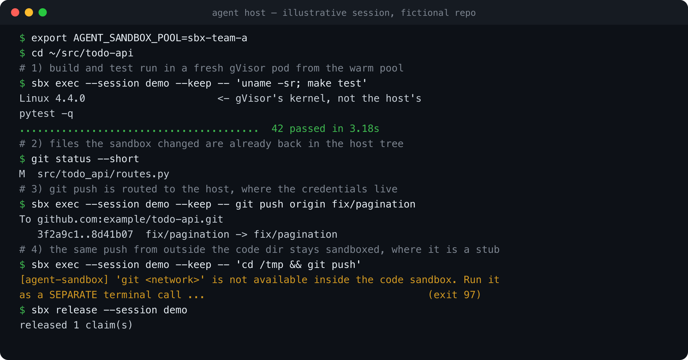
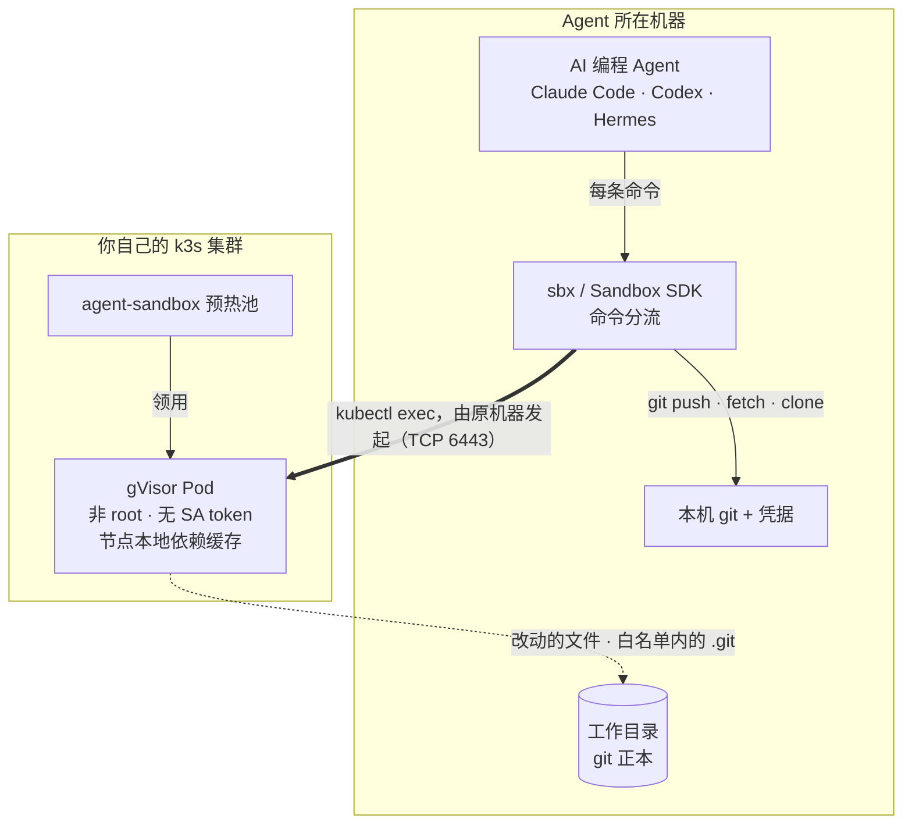

<div align="center">

# 🧊 self-hosted-agent-sandbox

**AI 编程 Agent 的命令，放到你自己 k3s 集群里的一次性 gVisor 沙箱去跑；git 凭据留在原机器，不进沙箱。**

[English](README.md) · 简体中文

[](https://pypi.org/project/self-hosted-agent-sandbox/) [](https://github.com/xiaoyaner0201/self-hosted-agent-sandbox/actions/workflows/ci.yml) [](LICENSE) [](pyproject.toml) [](https://gvisor.dev) [](https://github.com/kubernetes-sigs/agent-sandbox)



<sub>示意图，仓库和输出均为虚构。</sub>

</div>

---

## 🤔 为什么需要它

Claude Code、Codex、Hermes 这类编程 Agent，默认在**它自己所在的机器上**直接跑 `make`、`npm install`、`pytest`。这些命令会执行仓库、依赖和安装脚本里的任何代码，而同一台机器上就放着你的文件、SSH 私钥、云厂商 token 和内网访问权。一条带提示词注入的 issue，或者一个投毒的依赖包，就够出事了。

在本机起个容器能挡一部分，但内核是共用的，凭据往往也一起挂了进去；托管沙箱服务则要把代码送到别人的机器上。

这个项目的做法是：Agent 原地不动，只把**它执行的命令**送进你自己节点上的 gVisor Pod。代码双向同步，原机器上的工作目录始终是 git 正本；少数要用凭据的命令（`git push`、`fetch`、`clone` 等）自动转回原机器执行。

## ✨ 亮点

- 🧊 **gVisor 隔离，不需要 KVM**：每个会话一个独立 Pod，跑在用户态内核里（gVisor：Google 开源的容器沙箱，系统调用不直接落到宿主内核），非 root、不挂 ServiceAccount token。普通云主机就能部署。
- ⚡ **预热池秒领**：从提前启动好的池子里领一个沙箱约 0.2 秒，会话结束即删除。池子多节点共享，每个节点按租户保留依赖缓存，`npm install` 不用每次从头下。
- 🔑 **凭据不出门**：主机环境变量默认一个都不传，要传得点名。git 联网命令在原机器执行；沙箱里同名命令只是个桩，打印提示后以退出码 97 结束，Agent 一看就知道该换个方式调。
- 🔁 **双向同步有护栏**：往 `.git` 回写走白名单，沙箱里生成的东西没法偷偷埋一个 hook 等原机器下次 `git push` 时触发。
- 🐍 **接口小**：纯 Python SDK（`Sandbox`）加命令行 `sbx`，只用标准库，唯一外部程序是 `kubectl`。
- 🏗️ **集群脚本自带**：节点安装（给沙箱划死内存上限）、gVisor、最小权限账号和 kubeconfig、按租户的预热池、缓存清理，都在 `cluster/` 里。

> [!IMPORTANT]
> 沙箱挡的是「Agent 跑的东西伤到原机器」，不负责替你过滤送进去的内容。代码目录和同步路径里的文件原样进沙箱，点名转发的环境变量沙箱里所有命令都读得到。真实密钥别放工作目录里；接生产 Agent 之前先看一遍下面的[安全](#-安全)。

## 🏗️ 架构



连接永远由原机器主动发起：集群不需要能连回 Agent 主机，沙箱也不用开任何入站端口。

## 🚀 三步上手

**1. 装节点**（每台 Linux 机器都跑；脚本会拉官方 k3s 安装器，离线环境把它放到 `$SBX_DL/install-k3s.sh`）

```bash
# 第一台（作为 k3s 主节点）
SBX_NODE_IP=10.0.0.11 cluster/node-install.sh server
sudo cat /var/lib/rancher/k3s/server/node-token     # 拷到其他节点，存为 ./node-token

# 其他节点
SBX_NODE_IP=10.0.0.12 cluster/node-install.sh agent https://10.0.0.11:6443 ./node-token

# 每个节点
cluster/gvisor-node.sh
cluster/cache-gc-install.sh      # 可选：每天清理缓存
```

**2. 配集群**（只在第一台跑一次，这里的 `kubectl` 就是 `k3s kubectl`）

```bash
kubectl apply --server-side -f https://github.com/kubernetes-sigs/agent-sandbox/releases/download/v1.0.9/sandbox-with-extensions.yaml
kubectl create namespace sbx
kubectl apply -f cluster/runtimeclass.yaml -f cluster/rbac.yaml
cluster/render-pool.py --tenant team-a --image ghcr.io/you/agent-host:latest \
    --cache-mount /var/cache/pkg | kubectl apply -f -
cluster/make-kubeconfig.sh https://10.0.0.11:6443 > agent-sandbox.kubeconfig   # 拷到 Agent 主机
```

> [!TIP]
> 沙箱用和 Agent 主机**同一个镜像**，两边的路径、工具链和缓存相关变量就完全一致，不用额外配置。

**3. Agent 主机上用起来**

```bash
pip install self-hosted-agent-sandbox
export AGENT_SANDBOX_KUBECONFIG=$PWD/agent-sandbox.kubeconfig AGENT_SANDBOX_POOL=sbx-team-a
cd /workspaces/my-repo
sbx exec --session demo -- 'cat /proc/version; make test'     # 在新的 gVisor 沙箱里跑
sbx exec --session demo -- git push origin HEAD                # 在本机跑，用本机凭据
```

加 `--keep` 会保留沙箱，之后的 `sbx exec --session demo --keep` 都用同一个，直到 `sbx release --session demo`。`PATH` 里要有 `kubectl`，或者用 `AGENT_SANDBOX_KUBECTL` 指定。

在 Python 里用：

```python
from self_hosted_agent_sandbox import Sandbox
sb = Sandbox(cwd="/workspaces/my-repo", session="task-42")
print(sb.execute("pytest -q")["output"])
sb.close()  # 兼容旧行为：只发起异步删除，不代表已回收
```

公共 allocation 快照、构造失败恢复，以及对 Claim/Sandbox/Pod 做精确读回的有界释放，见 [生命周期归属](docs/lifecycle.md)。`close()` 和按 session 的 `release()` 保持原行为。

## 🔌 支持哪些 Agent

| Agent / 平台 | 接法 | 现状 |
|---|---|---|
| [Hermes Agent](https://github.com/NousResearch/hermes-agent) | 终端后端插件 [**hermes-sandbox-cluster**](https://github.com/xiaoyaner0201/hermes-sandbox-cluster) | ✅ 已在用，Hermes 0.21.5 和 0.22.7 验收全过 |
| Claude Code | 关掉自带的 Bash/Read/Write/Edit/Glob/Grep，改由 `sbx mcp` 提供同名工具，背后是沙箱 | 🧪 原型在实验集群上端到端跑通，尚未进正式版 |
| Codex CLI | 官方远端执行环境：沙箱里跑 `codex exec-server`，经 stdio 中继接回 | 🧪 原型在实验集群上端到端跑通，尚未进正式版 |
| Multica 运行时 | 经上面几个 Agent 适配接入；覆盖分配任务、Webhook 自动化（如 `pull_request`）和 PR 唤醒 | 🛠️ 计划中 |
| [OmniRoute](https://github.com/cheaper-inference/OmniRoute) | 技能运行时 `agent-sandbox`：`execute_command` / `eval_code` 从预热池领 Pod 执行（[接入说明](docs/omniroute.md)） | ✅ 上游 PR [#19130](https://github.com/cheaper-inference/OmniRoute/pull/19130) 已合并；实验集群已验证 |
| [Temporal](https://temporal.io) | Activity 调用 Python `Sandbox` API：领用 → 执行 → 验证回收（[接入说明](docs/temporal.zh-CN.md)） | 🧪 调用方自己维护的适配候选；有 SDK 0.3.0 隔离 canary 记录，本仓库不内置 |

其他程序直接调命令行或核心库即可。

## ⚖️ 和同类方案怎么选

| 方案 | 是什么 | 区别在哪 |
|---|---|---|
| [E2B](https://e2b.dev) | 基于 Firecracker 微虚拟机的沙箱服务，托管或自部署 | 本项目跑在普通 k3s + gVisor 上，节点不需要 KVM；面向「Agent 已经在某台机器上跑」的场景，自带代码同步和 git 回原机器 |
| [Daytona](https://www.daytona.io) | 带 API 服务、工作区和控制台的沙箱平台 | 本项目只是 Kubernetes 原语之上的一个库和命令行，没有自己的服务端要运维 |
| 直接用 [kubernetes-sigs/agent-sandbox](https://github.com/kubernetes-sigs/agent-sandbox) | 沙箱 Pod 和预热池的 CRD 与控制器 | 本项目以它为底座，补上领用/执行/释放、双向代码同步、命令分流和集群脚本 |
| 本机 Docker 或 Agent 自带沙箱 | 在 Agent 自己的机器上做隔离 | 和原机器共用内核与资源；本项目把命令放到别的节点上、跑在 gVisor 里，池子多个 Agent 共用 |

各有适用场景：代码可以出门、想省事，托管服务更轻松；想让 Agent 的命令只落在自己掌控的机器上，选这个。

## 🧩 仓库里有什么

| 部分 | 内容 |
|---|---|
| `cluster/` | 节点安装（给沙箱划固定内存上限）、gVisor、最小权限账号和 kubeconfig、按租户的预热池和每节点依赖缓存、缓存清理 |
| `src/self_hosted_agent_sandbox/` | 核心库（`Sandbox`）：领用、续期、释放，环境变量和文件同步，带 `.git` 白名单的代码双向同步，哪些命令回原机器执行。纯 Python，无依赖 |
| `sbx` | 基于核心库的命令行：`sbx exec`、`sbx shell`、`sbx release` |

正式入口是 **Python `Sandbox` API** 和 `sbx` 命令行；SDK 0.4.0 **没有 HTTP 服务，也没有持久作业服务**。业务编排、取消和回收验证由调用方负责；Kubernetes 是底层平台，不是让每个调用方再造一套 Job 后端的理由。

**0.4.0** 新增公共 allocation / verified-release API 和带确认的严格回传。源码和安装后 wheel 的本地门禁都已通过；新 API 还没做 Kubernetes/gVisor/Temporal 实机验收（Temporal canary 跑的是 0.3.0）。见[发行说明](docs/releases/0.4.0.md)。

SDK 负责命令分流、本地子进程清理和文件传输；控制器负责调度和到期；适配层负责持久恢复、取消策略和制品校验。「API 资源已消失」「远端进程已结束」「制品已收妥」是三个不同的结论。

## 显式生命周期与制品归属

```python
from self_hosted_agent_sandbox import Sandbox

# save_target(Allocation) 由调用方实现：同步、原子、持久写入。
# 保存 target._asdict()；用 Allocation(**saved_json) 恢复。
sb = Sandbox(cwd="/workspaces/my-repo", session="attempt-unique-id",
             on_allocation=save_target,
             config={"agent_sandbox_strict_pull": True})
result = sb.execute("make && mkdir -p out && cp dist/package.tar.gz out/package.tar.gz")
if result["returncode"] != 0:
    raise RuntimeError("build failed")
# 此处在主机检查预期 out/package.tar.gz、大小及 hash。
# 先停止/join 其他执行所有者，再显式回收（不会回传文件）：
released = sb.release_verified(timeout=15)
```

上面只是成功路径，不是完整异常策略。回传失败时命令可能已执行：修好传输/磁盘，或显式移动/移除冲突的宿主文件/目录，再在**同一实例 `sb.pull()`**，不要重跑命令或重新构造。strict close 回传失败会保留 claim，`force_remove=True` 不能绕过；默认 close 仍是 best-effort/异步删除，可能丢弃未收制品。两种模式的 pending 回传都会阻止下一次旧宿主覆盖；类型冲突不会自动递归删除宿主树。

持久保存 `error.allocation` / `ReleaseError.allocation`，用 `Sandbox.release_allocation(target, config=original_config, timeout=15)` 恢复回收，并单独保留最初的执行异常。verified release 需要显式授予 Sandbox CR 观察权限，inventory 不完整时 fail-closed；验证精确 API 名称/UID 消失，**不证明物理进程死亡**。见[完整生命周期合同](docs/lifecycle.md)。

## 构建能力边界

- 可运行沙箱镜像内已有的普通工具链；依赖、网络策略和资源额度由运维方配置。
- 隔离环境中实测了 rootless BuildKit **COPY-only** OCI 导出，不代表通用容器构建已成立：Dockerfile **RUN** 仍受当前沙箱 namespace/mount/安全限制。不能宣称支持 Docker-in-Docker、特权构建、任意 Dockerfile 或镜像推送。
- `dist`、`build`、`node_modules` 等[目录排除](docs/artifact-pull.md#directory-exclusions-and-explicit-export--目录排除与显式导出)不变。只将指定制品复制到代码目录内未排除的 `out/`；strict 回传不代替预期制品/hash 校验，也不是持久制品仓库。

## 🧭 哪些在沙箱，哪些在原机器

只有「登记过的命令 ＋ 碰不到文件的辅助命令」才会回原机器执行。辅助命令包括开头的 `cd <目录> &&`（目录须已存在且路径上没有符号链接）、`echo`/`printf`，以及只从管道读入的过滤命令（`grep`、`jq`、`head`、`tail`、`sort`、`uniq`、`cut`、`tr`、`wc`，只认固定的短选项），再加上 `>/dev/null`。而且不能离开代码目录：工作目录、每个 `cd`、git 命令里的每个本地路径（clone 的目标目录、`file://` 远端）都必须落在代码目录内，`$变量`、`~` 和未加引号的通配符不在原机器上展开。只要带了命令替换、子 shell、heredoc、写文件的重定向、其他程序、开关以外的变量前缀（`GIT_TRACE=1` 这类开关可以），或会让 git 运行其他程序的参数（`--upload-pack`、`clone -u/-c/--template` 等），整条都留在沙箱。

> [!IMPORTANT]
> 登记**具体子命令**，不要登记一整个能运行自定义代码的 CLI。比如 `gh` 的 alias 和 extension 都能执行任意程序，应登记 `gh pr create`、`gh pr view`，而不是 `gh`。沙箱里的这些 CLI 只是一层占位：会打印提示并以 97 退出，Agent 看到后就会把它拆成单独一条再执行。

## ⚙️ 配置项

都用环境变量设置；适配层也可以从自己的配置里读，比如 Hermes 的 `config.yaml` 里写 `agent_sandbox_*`。

| 变量 | 默认值 | 用途 |
|---|---|---|
| `AGENT_SANDBOX_POOL` | `agent-4g` | 从哪个预热池领沙箱 |
| `AGENT_SANDBOX_NAMESPACE` | `sbx` | 沙箱所在命名空间 |
| `AGENT_SANDBOX_KUBECONFIG` | `~/.kube/agent-sandbox.yaml` | 最小权限的 kubeconfig |
| `AGENT_SANDBOX_KUBECTL` | `kubectl` | kubectl 路径 |
| `AGENT_SANDBOX_SYNC_PATHS` | – | 按原路径推进沙箱的配置文件或目录 |
| `AGENT_SANDBOX_CODE_DIRS` | 任务目录 | 双向同步的代码目录 |
| `AGENT_SANDBOX_STRICT_PULL` | `false` | 回传失败时抛异常；严格 close 失败保留 claim 供重试。见[制品回传合同](docs/artifact-pull.md) |
| `AGENT_SANDBOX_HOST_COMMANDS` | git 网络操作、`git remote add/set-url` | 回原机器执行的命令前缀，按词匹配（设置后替换默认列表） |
| `AGENT_SANDBOX_FORWARD_ENV` | –（不转任何变量） | 要带进沙箱的主机变量，写变量名或通配，例如 `MY_BUILD_FLAG,NPM_CONFIG_REGISTRY`。不要把 token、key 写进来 |
| `AGENT_SANDBOX_ENV_SKIP` | – | 即使白名单匹配也不带进沙箱的变量名，支持 `*_TOKEN` 这类通配 |
| `AGENT_SANDBOX_TASK_FILES` | – | 任务根目录（`/workspaces/<ws>/<task>/`）里随工作目录推进沙箱的文件，不回传 |
| `AGENT_SANDBOX_IDLE_TTL` | `1800` | 集群侧到期时间（秒），有命令执行时自动续期 |
| `AGENT_SANDBOX_PERSISTENT` | `false` | 同一会话标签复用同一个沙箱 |
| `AGENT_SANDBOX_CLAIM_TIMEOUT` | `180` | 等沙箱就绪的最长秒数 |

回传游标现在只在载荷校验和本地应用成功后确认；`sb.pull()` 可以只重试接收、不重跑命令。严格模式显式开启，默认命令结果仍是 best-effort。构建调用方必须把指定制品从排除的 `dist/build` 复制到代码目录内未排除的 `out/`，并检查预期文件及 hash，不会默认放开构建/依赖全目录同步。详见[协议、兼容与限制](docs/artifact-pull.md)。

## 🌐 网络白名单

下表中的方向，均指由哪一方主动发起连接。

**Agent 主机 → 集群**（核心库只需要这一条）

| 端口 | 目标 | 用途 |
|---|---|---|
| TCP 6443 | k3s 主节点 | Kubernetes API：申请和释放沙箱、执行命令（`kubectl exec` 也经 API Server 转发） |

**集群节点之间**

| 端口 | 方向 | 用途 |
|---|---|---|
| TCP 6443 | 工作节点 → 主节点 | 加入集群、调用 API |
| TCP 10250 | 主节点 → 各节点 | kubelet：执行命令和查日志时，转发到沙箱所在节点 |
| UDP 8472 | 所有节点互通 | flannel VXLAN 容器网络 |
| TCP 2379–2380 | 主节点之间 | 只在多主节点（内置 etcd 高可用）时需要 |

**沙箱 → 外部**：按构建需要开，比如 Maven、npm、PyPI 镜像源，Go 代理，以及节点拉镜像用的镜像仓库。

> [!NOTE]
> 不需要开任何入站规则：沙箱不访问 Agent 主机，外部也不访问沙箱。代码同步和凭据命令都由 Agent 主机主动发起。如果 Agent 主机只能通过代理访问集群，在 kubeconfig 的 cluster 段加上 `proxy-url:` 即可，`kubectl exec` 支持 HTTP 和 SOCKS 代理。

## 🔒 安全

- 沙箱运行在 **gVisor** 里，用非 root 用户，不挂载服务账号 token，也不注入服务发现变量。
- **凭据留在原机器上。** 沙箱只负责执行和构建；没写进 `AGENT_SANDBOX_FORWARD_ENV` 的主机变量一个都不进沙箱（默认为空），需要凭据的 git 联网命令回原机器执行。
- 进沙箱的 git 配置按键名精确白名单放行：主机 `~/.gitconfig` 只带身份和日常设置（`user.name`、`user.email`、`init.defaultBranch`、`pull.rebase`、`push.default`、换行符和文件权限选项）；代码目录里每个仓库的 `.git/config` 和 `config.worktree` 另外保留 git 在沙箱里要用的部分（仓库格式、分支、远端地址和 fetch 规则）。别名、`core.sshCommand`、`core.askpass`、钩子目录、credential helper、include、`http.*`、`url.*` 一律不进，带 `用户名:密码@` 的值也去掉。沙箱被复用时这份配置整体替换，不保留旧的；解析失败时沙箱拿到的是空文件。
- 代码目录、同步路径以及适配层传入的预置目录里的其他文件按原样推进沙箱：别把 token 放在工作目录里（比如带真实密钥的 `.env`、带认证 token 的 `.npmrc`）。
- 回传到 `.git` 里的内容按白名单放行，只有对象、引用、日志、`HEAD`、`index`、`packed-refs` 这类；配置、钩子、gitfile 等一律保持原机器上的样子。原机器上的 git 以 `safe.bareRepository=explicit` 运行，也拒绝经由指向代码目录之外的符号链接写入。这样沙箱里做的任何事，都没法埋一个钩子让之后在原机器上执行的 `git push` 去跑。
- 依赖缓存按租户隔离，一个租户装了有问题的包，不会污染别的租户。
- Agent 主机用的服务账号权限最小：只能在一个命名空间里管理 `sandboxclaims`，并进入 Pod 执行命令。
- 回原机器执行的命令沿用主机进程自己的 `PATH`。分流只检查命令文本，不检查 `PATH` 解析到哪个 `git`，所以主机 `PATH` 里不要放 Agent 能写入的目录。

> [!WARNING]
> 默认不带任何主机变量进沙箱。只写构建需要的，例如 `AGENT_SANDBOX_FORWARD_ENV="MY_BUILD_FLAG,NPM_CONFIG_REGISTRY"`；不要把 token、API key 写进白名单，带进去的变量沙箱里每条命令都能读到。

## 🧪 测试

- `tests/route_table.py`（固定用例）和 `tests/route_fuzz.py`（随机生成命令交给真实 bash 执行，确认不会在代码目录外写文件）离线检查哪些命令回原机器执行：`python tests/route_table.py`。
- `tests/core_unit.py` 用假的 `kubectl` 离线检查报错、流式输出、`release`、变量白名单（默认为空：主机上的 API key 不会进沙箱；去掉的变量会被 unset）和 git 配置白名单（主机和仓库两份）。
- `tests/lifecycle_unit.py`（31）检查 fake kubectl 生命周期和真实本地 POSIX 进程组；`tests/artifact_pull.py`（11）、`tests/artifact_integrity.py`（10）、`tests/integration_cross.py`（5）使用真实 Docker 传输验证 ACK/恢复与交叉合同。源码和已安装 wheel 本地门禁已运行，不替代集群验收。
- `tests/e2e.sh` 用真实集群测 `sbx` 命令行：gVisor、变量同步、文件和 commit 回传、回原机器执行、沙箱复用和释放、退出码。
- 各适配仓库有自己的验收（Hermes：26 + 15 项端到端检查）。

## 🔍 会接触什么

- **运行** 你指定的 `kubectl`，用你给的 kubeconfig，只连这个 kubeconfig 里的 API Server。
- **推进沙箱的内容**：`AGENT_SANDBOX_FORWARD_ENV` 里列出的主机变量（默认没有）、`AGENT_SANDBOX_SYNC_PATHS` 和 `AGENT_SANDBOX_TASK_FILES` 里的文件、代码目录、适配层传入的预置目录（比如只读的 skills 副本），以及 git 配置里白名单内的部分。
- **在主机上写的内容**：只写代码目录，内容是沙箱在其中新建、修改或删除的文件（`.git` 里只回传历史和 index；不会经由指向代码目录之外的符号链接写入）。
- **没有其他网络请求**，没有遥测，不保存凭据，不自带后台进程。

## 🛣️ 状态

早期版本。核心库取自 Hermes 插件，那边经过了九轮独立发布审查。节点为 Linux x86_64，k3s v1.37。

## 📄 许可证

[Apache-2.0](LICENSE)
